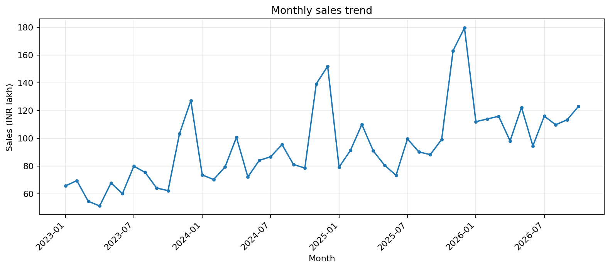
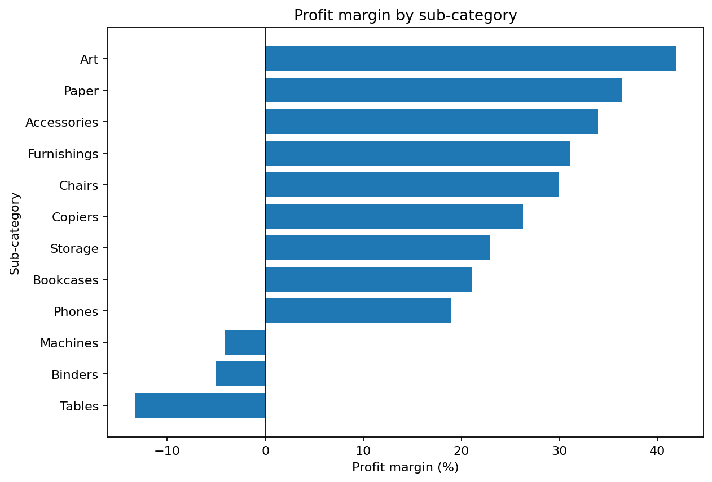
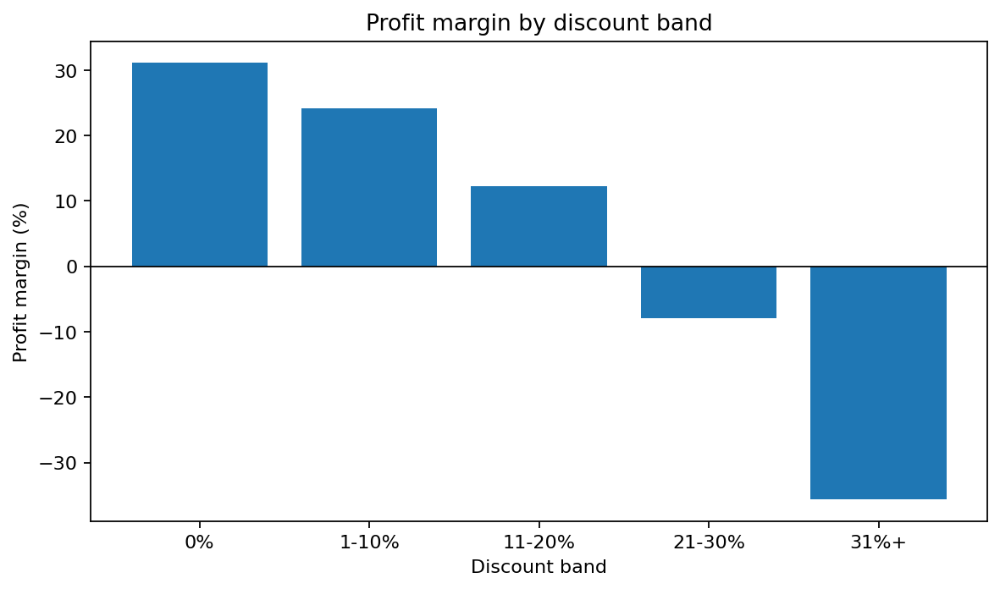
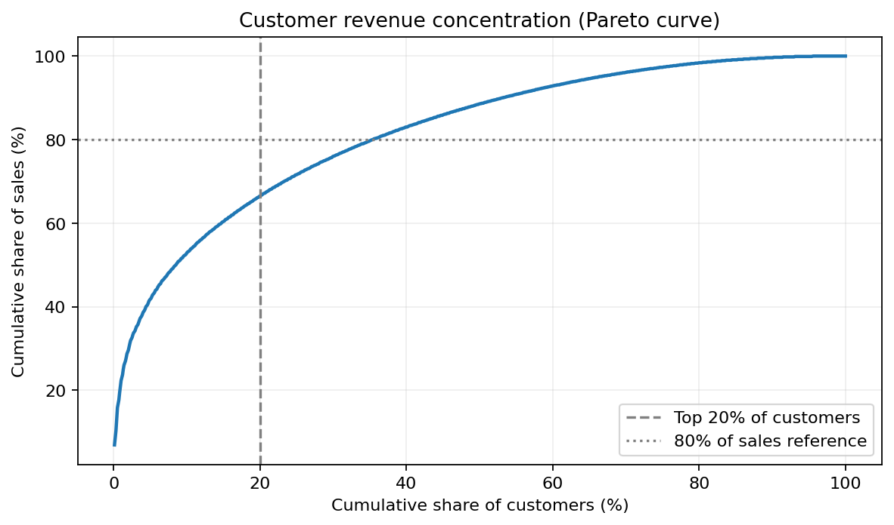
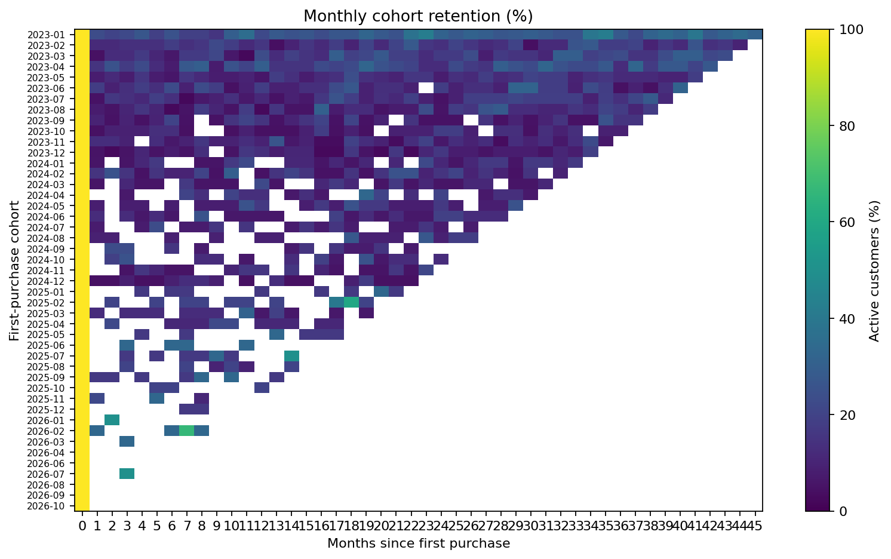
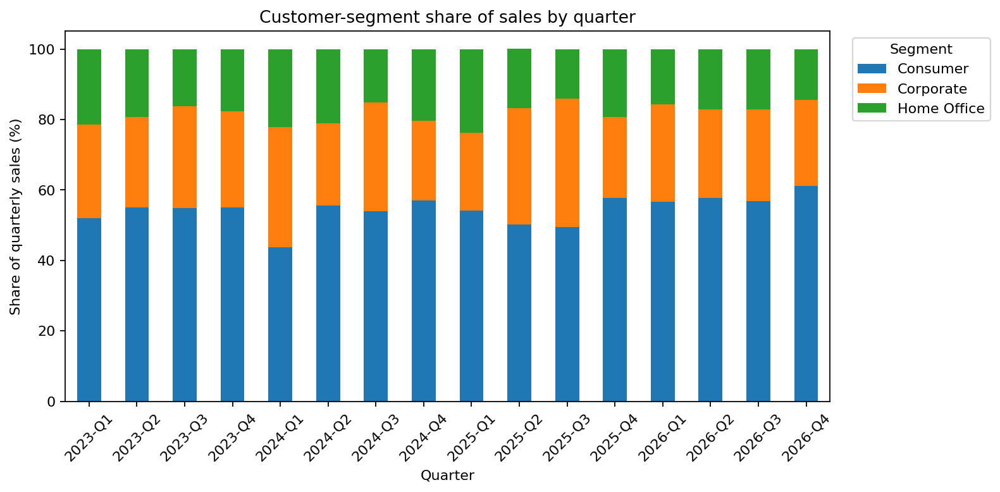
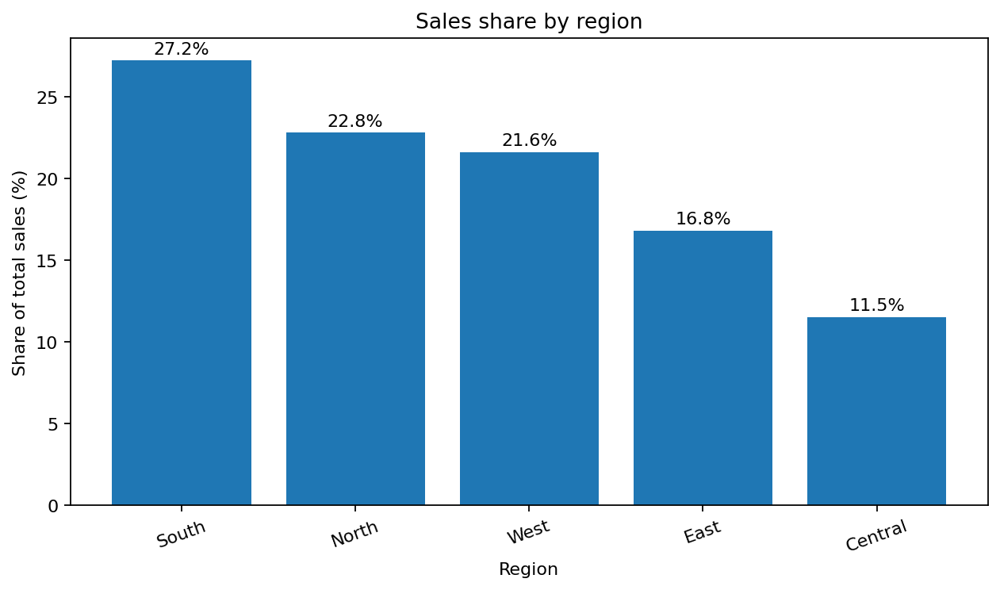
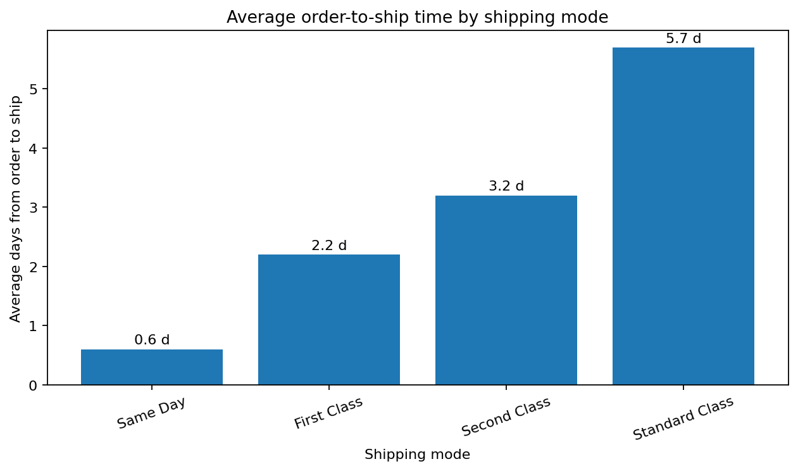

# Retail Sales and Profitability Analytics

A reproducible retail analytics case study built with **SQL (SQLite), Python and Power BI**. The project loads synthetic transaction data into a star-schema database, runs 12 SQL analyses, exports model/query tables, writes a findings summary and generates chart images.

> **Data note:** all bundled records are synthetic. The sample represents an Indian retailer and uses INR. It does not describe a real business or real customers. See `data/README.md` for the data dictionary and sample counts.

## Verified results from the bundled dataset

The results below were regenerated from the three CSV files in `data/raw/` on 9 November 2026 using `python run_all.py`.

| Metric | Result |
|---|---:|
| Sales | ₹436,161,366 |
| Profit | ₹66,369,053 |
| Overall profit margin | 15.22% |
| Distinct orders | 6,000 |
| Active customers in sales | 769 |
| Customer master records | 800 |
| Product master records | 120 |
| Sales line items | 14,992 |
| Top 20% customer share of sales | 66.5% |
| Customers with more than one order | 88.7% |
| Latest month YoY sales growth (October 2026) | +24.0% |

### Findings

- Tables, Binders and Machines are loss-making at the aggregate sub-category level in this generated sample. Tables have the lowest margin at -13.3%.
- Aggregate margin becomes negative in the 21-30% discount band. This is an observed association in synthetic data, not evidence that discounts alone caused the loss.
- South contributes the largest share of sales (27.2%); East has the lowest regional margin (14.5%).
- Standard Class has the highest share of sales lines with more than five days between the order date and ship date (54.6%). The file contains a **ship date, not a delivery date**, so this is an order-to-ship timing metric and must not be described as confirmed late delivery.

The generated `reports/findings.md` contains the full summary. SQL outputs are available as CSV files in `exports/`.

## Run the project

Python 3.10 or newer is recommended.

```bash
python -m venv .venv
```

Activate the environment and install the dependencies:

```bash
# Windows PowerShell
.venv\Scripts\Activate.ps1

# macOS / Linux
source .venv/bin/activate

pip install -r requirements.txt
```

Run the complete pipeline:

```bash
python run_all.py
```

**Important:** existing files in `data/raw/` are used as-is and are not overwritten. To intentionally regenerate the synthetic demo dataset, run:

```bash
python run_all.py --generate-sample
```

The pipeline builds `data/retail.db`, runs all SQL files in `sql/`, writes query and Power BI model exports to `exports/`, generates `reports/charts/*.png`, and refreshes `reports/findings.md`. Run `pytest -q` to execute the data-generator and database-builder tests.

## Output charts

The following chart images are generated from the SQL result tables and included in `reports/charts/`.

### Sales and profitability







### Customer analytics







### Region and operations





## SQL analyses included

| # | Business question | Main SQL technique | Export |
|---|---|---|---|
| 1 | Headline KPIs | Aggregates | `01_kpi_overview.csv` |
| 2 | Monthly sales, MoM and YoY growth | CTE, `LAG` | `02_monthly_trend_yoy.csv` |
| 3 | Profitability by category and sub-category | Join, `RANK` | `03_category_subcategory_profit.csv` |
| 4 | Profitability by discount band | `CASE`, aggregates | `04_discount_impact.csv` |
| 5 | Top loss-making products | `HAVING`, sort and limit | `05_loss_making_products.csv` |
| 6 | Regional sales share and margin | Window over aggregate | `06_region_performance.csv` |
| 7 | Customer sales concentration | Running-total window | `07_customer_pareto.csv` |
| 8 | Customer RFM segments | `NTILE`, `CASE` | `08_rfm_segmentation.csv` |
| 9 | Monthly cohort retention | CTE, `FIRST_VALUE` | `09_cohort_retention.csv` |
| 10 | Order-to-ship elapsed time by ship mode | Date arithmetic | `10_shipping_performance.csv` |
| 11 | Repeat purchase rate | Conditional aggregation | `11_repeat_rate.csv` |
| 12 | Segment share by quarter | Window partitioning | `12_segment_quarterly_share.csv` |

The queries use SQLite syntax. For MySQL 8, replace SQLite date functions such as `strftime` and `julianday` with the corresponding MySQL date functions.

## Power BI dashboard

Follow `powerbi/POWERBI_GUIDE.md` to load the four CSV model tables, create star-schema relationships and build a four-page dashboard. The repository includes the Python-generated analysis charts above; it does **not** include a Power BI `.pbix` file or screenshots of a separately built Power BI report.

## Project structure

```text
sql/                         12 analytical SQL queries
src/generate_data.py         Synthetic data generator
src/build_db.py              Input validation and SQLite star-schema builder
src/run_analysis.py          SQL exports, findings and charts
run_all.py                   End-to-end workflow; preserves existing raw data

data/raw/customers.csv       Customer master data
data/raw/products.csv        Product master data
data/raw/sales.csv           Sales line items
data/README.md               Data dictionary, assumptions and sample counts
exports/                     SQL results and Power BI model CSVs
reports/findings.md          Generated key findings
reports/charts/              Generated plot PNG files
powerbi/POWERBI_GUIDE.md     Power BI model, measures and report-page guide
```

## Assumptions and limitations

- Dataset is synthetic and deliberately contains patterns for learning SQL and analytics.
- Profit is sales less an estimated product cost; it excludes overhead, tax, returns, shipping cost and other operating costs.
- The data contains `ship_date` but no delivery timestamp or promised delivery date. The shipping query therefore measures order-to-ship elapsed time, not on-time delivery performance.
- The discount comparison is descriptive. It does not establish a causal relationship between discounting and profit.
- The repeat-purchase rate counts customers with more than one distinct order during the available sample period.

## Resume project description

Built a retail analytics pipeline using SQLite, 12 SQL queries (CTEs, window functions, cohort and RFM analysis) and Python visualisations. Analysed 14,992 sales line items across 6,000 orders; found 66.5% of sample sales came from the top 20% of active customers and identified three loss-making sub-categories. Created Power BI-ready star-schema exports and an eight-chart report. All findings are from synthetic data.
